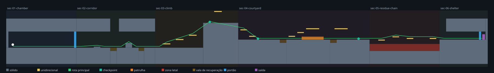

# W1-L1 — Especificação espacial, encontros, eventos e perigos

**Task:** BOLT-001 · Fonte de verdade: `content/levels/w1-l1.level.json` e `w1-l1.content.json`. Este documento é **derivado dos dados**; em caso de divergência, vale o JSON. Unidades em px; origem no canto superior esquerdo; Y cresce para baixo; mundo 7040×960; viewport de referência 800×450; corpo do jogador 30×46.
**Figura:** [`figures/W1-L1-layout.svg`](figures/W1-L1-layout.svg) (gerada por `scripts/levels/render-level-svg.js`; é auxílio de design, não asset do jogo).

## 1. Envelope de movimento usado (PROVISÓRIO)
Medido com `PlayerMotor` + `DEBUG_PLAYER_TUNING` (PR #161 @ `3ef8215`), piso plano, 60 Hz: pulo curto 25,2 px; pulo sustentado 129,4 px; pulo duplo 258,4 px; alcance de pulo correndo 194,3 px; pulo duplo correndo 337,3 px; Dash no chão 164,7 px; pulo+Dash 362,7 px; corrida 220 px/s; visível à frente 300 px, abaixo 180 px. **O tuning de debug não é aprovado**: reexecutar `scripts/levels/runtime-probes/` quando mudar.

## 2. Marcos espaciais
- Spawn (96, 674). Console de despertar em x 480–576. Porta da câmara (portão) em x 992–1024.
- Checkpoints (pés em x,y): `cp-01-terrace` (2976, 352) · `cp-02-courtyard` (3680, 600) · `cp-03-chain-entry` (5152, 600). Todos com ≥ 96 px de margem até a borda da superfície e ≥ 400 px de qualquer fonte de dano.
- Saída `exit-w1-l2` (6960, 520, 40×80) → `w1-l2`, atrás do portão `gate-shelter-exit` (6912–6944).
- Segredo: `s3-secret-ledge` (y 176) alcançável com pulo duplo a partir do terraço; compartimento em (3072, 128).

## 3. Seções
| Seção | x | Superfícies principais | Observação |
|---|---|---|---|
| sec-01-chamber | 0–1024 | s1-floor, s1-ceiling, paredes | Sem salto, sem ameaça. Portão fechado até usar o console. |
| sec-02-corridor | 1024–2176 | s2-floor-a/b/c, s2-rubble-low, s2-block-high, tetos | Duas valas de recuperação; obstáculo de 72 px ensina salto sustentado. |
| sec-03-climb | 2176–3392 | s3-base-floor, s3-ledge-a/b/c, s3-terrace | Subida em degraus de 64 px e primeiro pulo duplo (desnível 176 px). |
| sec-04-courtyard | 3392–5312 | s4-courtyard-0/1/2, valas, passarela | Descida em degraus, encontro opcional e desvio. |
| sec-05-residue-chain | 5312–6336 | s5-pad-1..4 sobre `hz-residue-pool` | Letal; quatro almofadas com luz de pouso. |
| sec-06-shelter | 6336–7040 | s6-floor, s6-roof, s6-back-wall | Entrada sem pressão, terminal de sincronização. |

## 4. Rota (pernas e razões calculadas)
Razão = max(vão ÷ alcance com redução por subida, desnível ÷ altura de salto). Gerada pelo validador estático.

|---|---|---|---|---|---|---|---|
| rn-00-spawn | s1-floor | 96 | start | — | — | — | — |
| rn-01-console | s1-floor | 528 | walk | — | — | — | sec-01-chamber |
| rn-02-corridor | s2-floor-a | 1088 | walk | — | — | — | sec-02-corridor |
| rn-03-rubble | s2-rubble-low | 1328 | jump | 0.12 | 0 | 16 | sec-02-corridor |
| rn-04-floor-a | s2-floor-a | 1440 | drop | — | 0 | -16 | sec-02-corridor |
| rn-05-floor-b | s2-floor-b | 1680 | jump | 0.49 | 96 | 0 | sec-02-corridor |
| rn-06-block | s2-block-high | 1792 | jump | 0.56 | 0 | 72 | sec-02-corridor |
| rn-07-floor-b-end | s2-floor-b | 1900 | drop | — | 0 | -72 | sec-02-corridor |
| rn-08-floor-c | s2-floor-c | 2096 | jump | 0.41 | 80 | 0 | sec-02-corridor |
| rn-09-base | s3-base-floor | 2240 | walk | — | — | — | sec-03-climb |
| rn-10-ledge-a | s3-ledge-a | 2344 | jump | 0.49 | 0 | 64 | sec-03-climb |
| rn-11-ledge-b | s3-ledge-b | 2536 | jump | 0.55 | 80 | 64 | sec-03-climb |
| rn-12-ledge-c | s3-ledge-c | 2728 | jump | 0.55 | 80 | 64 | sec-03-climb |
| rn-13-terrace | s3-terrace | 2976 | doubleJump | 0.68 | 96 | 176 | sec-03-climb |
| rn-14-step-1 | s4-service-step-1 | 3472 | drop | — | 32 | -96 | sec-04-courtyard |
| rn-15-step-2 | s4-service-step-2 | 3600 | drop | — | 32 | -96 | sec-04-courtyard |
| rn-16-courtyard-0 | s4-courtyard-0 | 3680 | drop | — | 0 | -56 | sec-04-courtyard |
| rn-17-courtyard-1 | s4-courtyard-1 | 4144 | jump | 0.49 | 96 | 0 | sec-04-courtyard |
| rn-18-courtyard-2 | s4-courtyard-2 | 4880 | jump | 0.49 | 96 | 0 | sec-04-courtyard |
| rn-19-pad-1 | s5-pad-1 | 5488 | jump | 0.66 | 128 | 0 | sec-05-residue-chain |
| rn-20-pad-2 | s5-pad-2 | 5696 | jump | 0.71 | 112 | 48 | sec-05-residue-chain |
| rn-21-pad-3 | s5-pad-3 | 5904 | jump | 0.58 | 112 | -24 | sec-05-residue-chain |
| rn-22-pad-4 | s5-pad-4 | 6240 | doubleJump | 0.71 | 240 | 0 | sec-05-residue-chain |
| rn-23-shelter | s6-floor | 6400 | jump | 0.25 | 48 | -24 | sec-06-shelter |
| rn-24-sync | s6-floor | 6768 | walk | — | — | — | sec-06-shelter |
| rn-25-exit | s6-floor | 6980 | walk | — | — | — | sec-06-shelter |
| ro-cw-step-1 | s4-catwalk-step-1 | 4176 | jump | 0.43 | 0 | 56 | sec-04-courtyard |
| ro-cw-step-2 | s4-catwalk-step-2 | 4304 | jump | 0.43 | 32 | 56 | sec-04-courtyard |
| ro-cw-1 | s4-catwalk-1 | 4480 | jump | 0.43 | 32 | 56 | sec-04-courtyard |
| ro-cw-2 | s4-catwalk-2 | 4896 | doubleJump (alt. jumpDash) | 0.66 | 224 | 0 | sec-04-courtyard |
| ro-cw-return | s4-courtyard-2 | 4950 | drop | — | 0 | -168 | sec-04-courtyard |
| ro-sec-ledge | s3-secret-ledge | 3096 | doubleJump | 0.68 | 0 | 176 | sec-03-climb |
### SOLIDS

Rotas opcionais: `route-catwalk-bypass` (desvio sobre a unidade; recompensa `pk-repair-catwalk`; aceita pulo duplo ou pulo+Dash) e `route-secret-diagnostic`. A rota principal **não** exige Dash nem tiro (verificado pelo validador).

## 5. Encontro opcional — `en-maint-unit-01`
| Campo | Valor |
|---|---|
| Arquétipo | `enemy-cybercore-maint-unit-defective` (nome PROPOSTO; conferir com o World Bible antes de aprovar, D-12) |
| Posição | sobre `s4-courtyard-1`; patrulha x 4320–4640; corpo 48×44 |
| Estado inicial | dormente; acorda com jogador a ≤ 320 px em x e faixa y 160 |
| Telegraph | 1,2 s de reinício antes de agir (evento `evt-unit-reboot`) |
| Movimento | 60 px/s (27% da corrida), pausa de 0,6 s nas pontas |
| Falha ("glitch") | a cada 2 trechos, 1,4 s com núcleo exposto e sem dano de contato |
| Dano de contato | 1 unidade relativa, invulnerabilidade de 1,0 s (**PROVISÓRIO**, D-06) |
| Vida | 3 equivalentes de tiro base; núcleo exposto ×2 (**PROVISÓRIO**, D-01/D-06) |
| Saltável | sim (altura 44 px vs. salto de 129 px) |
| Evitável | sim: rota da passarela, ou saltando sobre a unidade |
| Checkpoint | `cp-02` a 616 px do limite esquerdo da patrulha |
| Reinício | reseta ao respawn do jogador |
Aviso conhecido do validador: queda da passarela (216 px, > 180 px visíveis) cai perto da unidade dormente; aceito como risco de design porque a unidade avisa por 1,2 s. Registrado na matriz de QA.

## 6. Perigos
| ID | Tipo | Retângulo (x,y,w,h) | Efeito |
|---|---|---|---|
| hz-pit-1 | vala de recuperação | 1520,720,96,48 | sem dano; saída por pulo (verificada por bot) |
| hz-pit-2 | vala de recuperação | 1936,720,80,48 | idem |
| hz-trench-1 | vala de recuperação | 4000,600,96,48 | idem |
| hz-trench-2 | vala de recuperação | 4736,600,96,48 | idem |
| hz-residue-pool | zona letal | 5312,664,1024,104 | PROPOSTA: dano leve e respawn em `cp-03` (D-06) |

## 7. Eventos e interação
Sequência principal: `evt-level-enter` → `evt-control-granted` → (usar console) `evt-console-used` abre `gate-chamber-exit` → corredor → … → `evt-shelter-entered` → (terminal) `evt-sync-activated` abre `gate-shelter-exit` e emite `evt-level-complete`.
- Interáveis que abrem portões têm **failsafe**: dica pulsante após 45 s, ativação automática após 90 s (necessário porque o runtime ainda não tem ação de interação, D-09).
- Gates são colliders adicionados/removidos dinamicamente (D-08): exige suporte do `CollisionWorld`.
- Flags persistentes: `w1l1-console-used`, `w1l1-secret-diagnostic`, `w1l1-sync-activated`. Esquema de save: D-11.

## 8. Política de respawn (PROPOSTA)
Morte ou zona letal → último checkpoint ativado; restaura vida; invulnerabilidade 1,5 s; reinicia inimigos e coletáveis posteriores ao checkpoint; mantém flags persistentes. Convenção de posicionamento do corpo: D-10.

## 9. Superfícies (referência completa)
### Sólidos
| ID | x | y | w | h |
|---|---|---|---|---|
| s1-wall-left | 0 | 288 | 32 | 432 |
| s1-ceiling | 32 | 288 | 992 | 192 |
| s1-floor | 0 | 720 | 1024 | 240 |
| s2-ceiling-a | 1024 | 288 | 496 | 192 |
| s2-ceiling-b | 1648 | 288 | 528 | 192 |
| s2-floor-a | 1024 | 720 | 496 | 240 |
| s2-rubble-low | 1280 | 704 | 96 | 16 |
| s2-pit1-bed | 1520 | 768 | 96 | 192 |
| s2-floor-b | 1616 | 720 | 320 | 240 |
| s2-block-high | 1744 | 648 | 96 | 72 |
| s2-pit2-bed | 1936 | 768 | 80 | 192 |
| s2-floor-c | 2016 | 720 | 160 | 240 |
| s3-base-floor | 2176 | 720 | 704 | 240 |
| s3-terrace | 2880 | 352 | 512 | 608 |
| s4-courtyard-0 | 3392 | 600 | 608 | 360 |
| s4-trench-1-bed | 4000 | 648 | 96 | 312 |
| s4-courtyard-1 | 4096 | 600 | 640 | 360 |
| s4-trench-2-bed | 4736 | 648 | 96 | 312 |
| s4-courtyard-2 | 4832 | 600 | 480 | 360 |
| s5-pool-bed | 5312 | 768 | 1024 | 192 |
| s6-floor | 6336 | 600 | 704 | 360 |
| s6-roof | 6432 | 288 | 576 | 192 |
| s6-back-wall | 7008 | 288 | 32 | 312 |
### Unidirecionais
| ID | x | y (topo) | w | h |
|---|---|---|---|---|
| s3-ledge-a | 2288 | 656 | 112 | 12 |
| s3-ledge-b | 2480 | 592 | 112 | 12 |
| s3-ledge-c | 2672 | 528 | 112 | 12 |
| s3-secret-ledge | 3040 | 176 | 112 | 12 |
| s4-service-step-1 | 3424 | 448 | 96 | 12 |
| s4-service-step-2 | 3552 | 544 | 96 | 12 |
| s4-catwalk-step-1 | 4128 | 544 | 96 | 12 |
| s4-catwalk-step-2 | 4256 | 488 | 96 | 12 |
| s4-catwalk-1 | 4384 | 432 | 192 | 12 |
| s4-catwalk-2 | 4800 | 432 | 192 | 12 |
| s5-pad-1 | 5440 | 600 | 96 | 12 |
| s5-pad-2 | 5648 | 552 | 96 | 12 |
| s5-pad-3 | 5856 | 576 | 96 | 12 |
| s5-pad-4 | 6192 | 576 | 96 | 12 |
