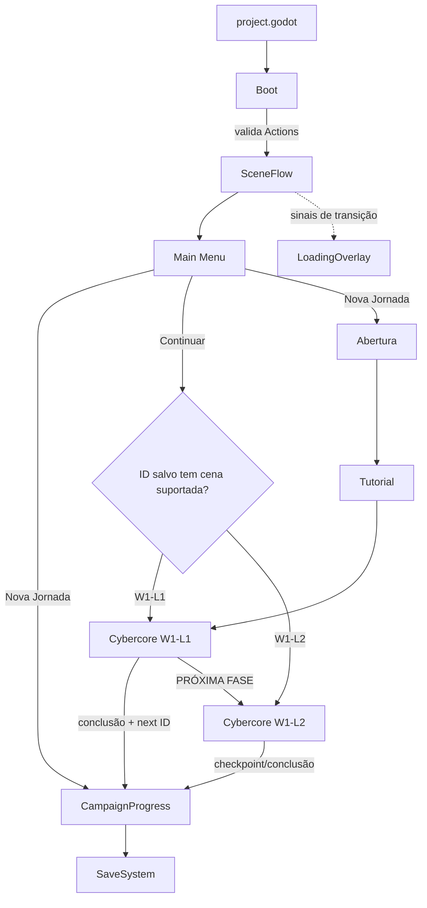
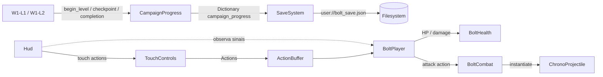
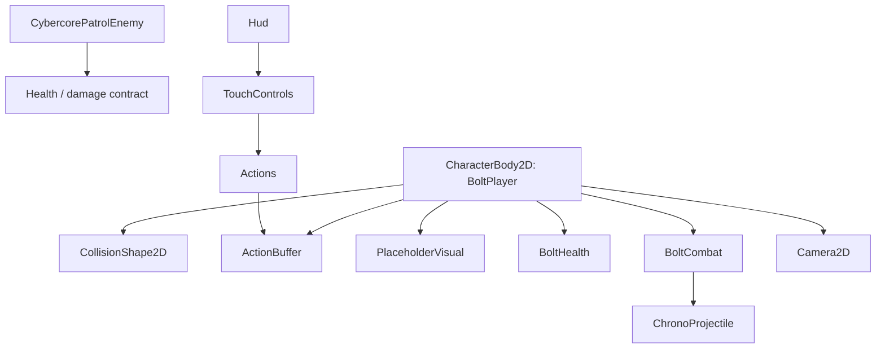

# Arquitetura atual — mapa de runtime e contratos

**Snapshot:** 2026-11-26; baseline de código após PR #47 e documentação após reconciliação de Etapa 02.  
**Engine:** Godot 4.7.2, GDScript tipado, 2D, renderer GL Compatibility provisório.  
**Plataforma de produto:** Android empacotado, paisagem, touch prioritário.  
**Status:** mapa estático do que existe; não é proposta de migração nem declaração de arquitetura final aprovada.

## 1. Composição da aplicação

O projeto usa quatro autoloads declarados em project.godot:

| Autoload | Implementação | Ownership |
|---|---|---|
| SceneFlow | scripts/core/scene_flow.gd | Coordena transições, carregamento threaded, exclusão mútua, sinais de sucesso/falha e bloqueio/limpeza de input |
| SaveSystem | scripts/core/save_system.gd | Envelope JSON versionado, checksum, arquivo temporário, backup e recuperação |
| CampaignProgress | scripts/campaign/campaign_progress.gd | Schema de domínio da campanha, IDs estáveis, checkpoint, fase atual e conclusão; delega I/O ao SaveSystem |
| LoadingOverlay | scenes/ui/loading_overlay.tscn | Apresentação global de loading; observa sinais do SceneFlow e não é dono do estado da transição |

### Fluxo de boot e navegação

- Boot valida as ações obrigatórias do Input Map antes de abrir o menu.
- MainMenu mantém um mapa explícito de destinos implementados (W1-L1 e W1-L2); não infere W1-L3 ou outras fases futuras.
- Nova Jornada reseta somente o domínio campaign_progress quando o envelope pode ser lido; a sessão pode continuar sem persistência quando o save está ilegível, sem apagá-lo implicitamente.
- Continuar consulta CampaignProgress e só aceita destinos cujo ID esteja no mapa e cuja PackedScene exista.
- A abertura e o tutorial são fluxo de Nova Jornada; Continuar vai diretamente à fase salva.

## 2. Ownership de estado e dados

| Estado | Fonte de verdade | Persistência |
|---|---|---|
| Velocidade, estado de movimento, Dash e cooldown transitório | BoltPlayer / BoltTuning | Não persistido |
| HP atual e máximo | BoltHealth | Não persistido entre sessões no contrato atual |
| Cooldown/ataque e projéteis ativos | BoltCombat / ChronoProjectile | Não persistido |
| Ações pressionadas e pointer IDs | TouchControls / ActionBuffer / Actions | Não persistido; limpo em pausa, foco e transição |
| Fase atual, checkpoint ativo e fases concluídas | CampaignProgress | SaveSystem, schema v1 |
| Envelope, checksum e backup | SaveSystem | user://bolt_save.json |
| Pausa, overlay de resultado e notificação | Hud | Estado de apresentação, não fonte de progresso |
| Destino e estado da transição | SceneFlow | Transitório; não persistido |

**Regra de integridade:** CampaignProgress persiste IDs/valores serializáveis, nunca referências a Nodes/Resources. SaveSystem permanece agnóstico ao schema de domínio.

## 3. Composição do player e combate

- BoltPlayer é o proprietário da movimentação, estados, colisão e coordenação de componentes filhos.
- ActionBuffer transforma edges de input em janelas curtas medidas em ticks de física; não é fonte de verdade de cooldown ou estado de movimento.
- BoltHealth possui HP e emite sinais de alteração/depleção; HUD observa esses sinais.
- BoltCombat controla cadência e instancia ChronoProjectile; valores da Pistola Crono são provisórios.
- Camera2D acompanha BOLT; os scripts de fase definem limites específicos.
- CybercorePatrolEnemy é um inimigo-base provisório de patrulha/contato, não um catálogo de arquétipos nem chefe.

## 4. Contratos de fase e mundo

| Componente | Base física | Responsabilidade | Estado |
|---|---|---|---|
| PlatformBlock | StaticBody2D | Geometria sólida reutilizável | Integrado |
| MovingPlatform | AnimatableBody2D | Movimento determinístico em physics tick, ping-pong e transporte nativo do CharacterBody2D | Integrado; não inserido em fase aprovada |
| OneWayPlatform | PlatformBlock / CollisionShape2D | Passagem ascendente e aterrissagem descendente via one_way_collision nativa | Integrado; não inserido em fase aprovada |
| TimedEnergyGate | Area2D + Timer | Janela cíclica ativa/inativa e dano por contato | Integrado; regressão de estado inicial corrigida na PR #47 |
| BoltCheckpoint | Area2D / componente de fase | Ativação, ID estável e posição de respawn | Integrado em W1-L1/W1-L2 |
| BoltHealthPickup | Area2D | Cura limitada e emissão de collected | Integrado em W1-L1 |

W1-L1 e W1-L2 possuem scripts de composição de nível próprios. Eles conectam sinais do player, HUD, checkpoint, kill zone, pickups/gates e objetivo. O nível decide spawn, limites de câmera, respawn e transição; CampaignProgress recebe IDs persistentes.

## 5. Limites de dependência e lifecycle

1. UI não altera diretamente a velocidade/física do player; publica ações e chama operações de fluxo de aplicação.
2. HUD observa vida/cooldown por sinais e não persiste progresso.
3. Level scripts podem compor componentes de gameplay e conectar sinais, mas não armazenam referências de Nodes no save.
4. CampaignProgress depende de SaveSystem; SaveSystem não depende de CampaignProgress.
5. LoadingOverlay observa SceneFlow; não inicia transições próprias nem decide destinos.
6. SceneFlow impede transições concorrentes e coordena pause/input lock. HUD libera a pausa antes de solicitar uma saída iniciada pelo jogador; SceneFlow restaura estado em falha.
7. TouchControls e ActionBuffer limpam ações/pointers em pausa, cancelamento, perda de foco, ocultação e transição.
8. Existe uma dependência de tipo bidirecional localizada: BoltPlayer mantém referência tipada a BoltCombat como componente filho, enquanto BoltCombat mantém referência tipada/cast do parent para BoltPlayer. É composição funcional atual, não prova de ciclo de runtime; registrar como acoplamento para revisão, sem refatorar até haver necessidade de reutilização/testabilidade que justifique mudança.
9. MovingPlatform e OneWayPlatform não devem ser adicionadas a uma fase sem decisão de level design e playtest.
10. Parâmetros de BoltTuning, projétil, dimensões, margens de colisão e tempos de gate permanecem provisórios até validação de gameplay.

## 6. Lacunas arquiteturais confirmadas

| Área | Estado | Próximo contrato necessário |
|---|---|---|
| Dialogue / Narrative Flags | Não implementado | IDs de diálogo/flag, persistência, skip e replay |
| Audio Events / Audio Buses | Não implementado | Eventos sem dependência de mixagem, buses, lifecycle e opções |
| Boss / Arena | Não implementado | Máquina de estados, fases, telegraphs, dano, recompensa e retry |
| Inventory / upgrades / fragments | Não implementado | Somente após decisão de escopo e modelo de domínio |
| Enemy AI | Patrulha simples provisória | Percepção, estados, navegação, telegraphs e limites |
| Asset catalog | Parcial; placeholders | IDs, proveniência/licença, import settings, budgets e estado |
| Save migration | Schema v1 sem migração futura | Migrações explícitas e regressões quando novos campos forem aprovados |
| Android lifecycle | CI exporta APK debug | Teste físico de foco, background, encerramento, retomada e persistência |\n| Acoplamento Player/Combat | BoltPlayer referencia BoltCombat e BoltCombat referencia BoltPlayer | Manter enquanto composição é local; reavaliar antes de extrair/reutilizar Combat ou adicionar múltiplos owners |
| Safe area / touch físico | Testes sintéticos | Validação em aparelhos identificados, barras/gestos e recortes |

## 7. Evidência e limites

- Godot 4.7.2.
- PR #47 pós-merge: 88 testes/553 verificações/0 falhas.
- CI valida import/parse, compilação de scripts, carregamento/instanciação de cenas e exportação Android debug.
- PR #47 APK debug: 28.461.057 bytes, SHA-256 c3ca03958eecf120f1a9f5f1e4fae3851fb7560bca303c8eb5a930f987b58123, assinatura v2/v3 válida.
- O APK não foi instalado em aparelho. Não há evidência de renderização, touch físico, safe area real, FPS, memória, temperatura ou lifecycle Android.

## 8. Resultado da auditoria arquitetural estática — Etapa 03

- Os quatro autoloads e suas dependências foram conferidos contra project.godot e scripts reais.
- Os 30 scripts de runtime e 19 cenas foram inventariados/revistos; CI Godot valida compilação dos scripts e carregamento/instanciação das cenas.
- Fluxos de boot, menu, abertura/tutorial, W1-L1/W1-L2, transições, loading, save/progress, player, combate, HUD, touch e componentes de plataforma foram mapeados.
- Não foi identificado ciclo entre autoloads/serviços: CampaignProgress depende de SaveSystem; LoadingOverlay observa SceneFlow; SceneFlow depende apenas do contrato Actions; SaveSystem permanece isolado.
- Um acoplamento de tipo local BoltPlayer↔BoltCombat foi identificado e documentado. É uma composição pai/filho de owner único, sem ciclo de runtime/estado; permanece como exceção consciente. Reavaliar se Combat for extraído/reutilizado ou houver múltiplos owners.
- Contratos de Dialogue, Audio, Boss, Inventory e IA avançada permanecem como requisitos futuros; não criar abstrações vazias antes de consumidores reais.
- Nenhuma migração de pastas ou reescrita foi necessária.

**Etapa 03: CONCLUÍDA — baseline arquitetural documentado, com uma exceção local explicitamente registrada.**
